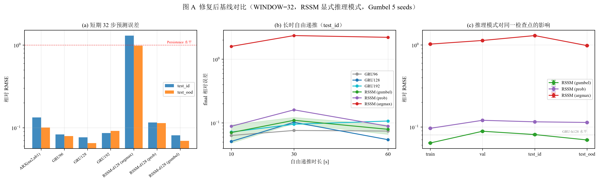
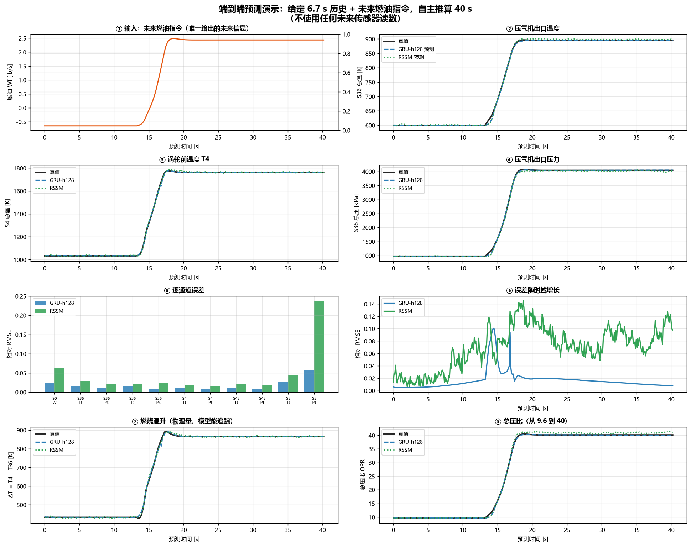

# PC-LWM：面向部分可观测航空发动机的物理约束潜在世界模型

[](https://github.com/SJiale/pclwm-aero-world-model)
[](https://huggingface.co/datasets/leran0326/pclwm-agtf30e-dynamic)
[](https://www.python.org/)
[](https://pytorch.org/)

> **Physics-Constrained Latent World Model (PC-LWM) for Partially Observable Aero-Engines**

Learn an action-conditioned, Simulink-free dynamic surrogate of an aero-engine from
AGTF30e simulation data, and study whether a physics-constrained RSSM (PC-LWM) beats a
deterministic GRU baseline under **partial observability** and **hidden degradation**.

---

## 最新进展（2026-11-03）

> 详见 [docs/WORKLOG_20261103.md](docs/WORKLOG_20261103.md) 与 [docs/DIAGNOSIS_REPORT.md](docs/DIAGNOSIS_REPORT.md)

### 数据集：A/B/C 三组 26 条轨迹

| 组 | 条数 | 覆盖 | 用途 |
|---|---|---|---|
| **A** | 12 | ΔPLA 25–38 deg，环境固定 | 单输入动态辨识 |
| **B** | 6 | ΔAlt 0–25 kft，ΔMN 0–0.75 | 环境独立影响 |
| **C** | 8 | 三输入异步 | 多输入耦合 |

每条 39 列 × 8001 行，含 **外部输入（PLA/Alt/MN）+ 转子状态（N2int/N2dot/N3dot）+ 燃油指令与实际值**。
旧数据的这两个维度完全缺失。

**数据划分**（按完整轨迹，无窗口泄漏）：train 17 / val 4 / test_id 2 / test_ood 3

### 基线结果（WINDOW=32，历史 3.36 s，HORIZON=32）

| 模型 | 参数 | test_id | test_ood | 长时 60 s |
|---|---|---|---|---|
| ARX(na2,nb1) | **70** | 0.1332 | 0.1007 | 0.2191 |
| GRU-h128 | 301 K | **0.0766** | **0.0650** | 0.0545 |
| RSSM-d128 (gumbel, 5 seeds) | 940 K | 0.0808 ± 0.0016 | 0.0695 ± 0.0006 | 0.0793 |
| RSSM-d128 (argmax) | 940 K | 1.3027 | 0.9832 | 2.2068 |

### RSSM 根因诊断：训练/推理采样不一致

`RSSM.imagine` 中的 `"gumbel" if self.training else "argmax"` 导致：

- 训练用 Gumbel 采样，推理用 Argmax
- 先验分布接近均匀（熵 3.333 vs 均匀 3.466，top1−top2 差仅 0.047）
- **train/eval 输出差 159%**，argmax 输出幅值是 gumbel 的 2 倍
- 修复后 test_id 从 **1.3027 → 0.0808**（17 倍 → 1.05 倍）

**同时发现**：`free_bits=1.0` 过高，32 个潜维度 KL 全部低于阈值（0% 超阈值），KL 项梯度为零。



### 待办

1. 重训 RSSM，`free_bits` 1.0 → 0.2
2. 统一推理策略（gumbel 最优，但需确定性时用 prob）
3. 修复后重新评估是否值得做双时间尺度 / 物理约束
## 1. 项目状态（2026-11-03）

| 阶段 | 状态 |
|---|---|
| 可用动态数据源 | ✅ 已确定：NASA **AGTF30e** |
| 数据生成 | ✅ 30 条轨迹（5 种 PLA 激励 × 6 种工况）|
| 端到端预测 | ✅ 已验证（6.7 s 历史 → 40 s 推算，误差 1.7–2.8%）|
| GRU 基线 | ✅ 容量消融完成（hidden 96/128/192 × 3 种子）|
| RSSM | ⚠ 已训练，但 **KL 项卡死**（未修复）|
| PC-LWM（物理约束）| ❌ `physics.py` 存在但**未接入训练** |
| Mask 实验（A 组）| ❌ 未开始 |
| 隐藏退化（B 组）| ❌ 未开始，入口已找到 |

**当前结论**：在**完整观测 + 标称参数**（即 A0/B0）条件下，**确定性 GRU 优于 RSSM**。
这是预期结果，不是失败——RSSM 的价值只可能在部分可观测场景体现。

---

## 2. 快速开始

### 2.1 环境

```bash
# Python 3.13 建议（本机验证版本）
python -m venv .venv
.venv\Scripts\activate          # Windows

pip install torch --index-url https://download.pytorch.org/whl/cu128
pip install numpy scipy pandas pyyaml matplotlib
```

**本机实测环境**：torch 2.9.1+cu128 / numpy 2.5.4 / scipy 1.18.1 / pandas 3.1.0

### 2.2 运行评估（用已含检查点，无需训练）

```bash
set PYTHONPATH=%CD%\src
python scripts/eval_package.py
```

预期输出（测试集相对 RMSE，11 通道）：

```
Persistence   0.1701
ARX           0.1299
GRU           0.0175
RSSM          0.0328
```

### 2.3 长时自由递推评估（40 s，不使用未来真值）

```bash
python scripts/long_eval_fixed.py
```

### 2.4 复现容量消融

```bash
python scripts/exp_capacity.py       # 9 配置，约 85 分钟（GPU）
python scripts/plot_capacity.py      # 出图
```

---

## 3. 目录结构

```
.
├── README.md
├── requirements.txt
├── .gitignore
├── src/aero_world_model/          # 模型代码
│   ├── models/rssm.py             # RSSM（DreamerV3 PyTorch 移植）
│   ├── models/baselines.py        # BaselineGRU / BaselinePersistence
│   ├── models/sampling.py         # Gumbel-max 采样（straight-through）
│   ├── losses/physics.py          # 物理约束（未接入训练）
│   ├── losses/mtw.py              # 多步预测损失
│   └── training/offline.py        # WorldModel 封装
├── scripts/                        # 数据准备 / 训练 / 评估 / 画图
├── configs/
│   ├── train_config.yaml          # 训练超参
│   └── agtf30_model_params.md     # AGTF30e 参数与工况记录
├── data/
│   ├── data.npz                   # 30 轨迹 × 8001 点 × 16 通道（6.1 MB）
│   ├── splits.json                # train=15 / val=5 / test=10
│   ├── meta.json                  # 每条轨迹的 profile/Alt/MN/增益
│   └── agtf30_traj/               # 5 条代表性原始 CSV（38 列）
├── checkpoints/
│   ├── v2_gru.pt                  # v2 GRU（hidden=192）
│   ├── v2_rssm.pt                 # v2 RSSM
│   └── capacity/h128_s{0,1,2}.pt  # 容量消融最优配置（3 种子）
├── results/                        # JSON 指标
│   ├── eval_package.json
│   ├── long_eval_fixed.json
│   ├── capacity_ablation/results.json
│   └── verify_unified.json
├── figures/                        # 关键图（含 fig40 预测演示）
├── model_gen/                      # MATLAB 数据生成脚本（需 AGTF30e）
└── docs/                           # 详细文档
    ├── START_HERE.md               # 交接入口
    ├── HANDOFF_REPORT.md           # 完整交接报告
    ├── DATASET_CARD.md             # 数据集说明
    ├── REPRODUCE.md                # 复现命令
    ├── NEXT_STEPS.md               # 下一步任务
    ├── EXPERIMENT_INDEX.csv        # 实验-数据-代码-结果 对应表
    └── MANIFEST_SHA256.txt         # 文件校验值
```

---

## 4. 数据

**来源**：NASA AGTF30e（Advanced Geared Turbofan 30,000 lbf — electrified）
- 上游仓库：https://github.com/nasa/AGTF30
- 本地版本：`AGTF30SysDyn_PExPIn.slx`（398 KB，2025-11-20）
- 求解器：ode4 定步长 0.015 s

**30 条轨迹**（120 s，8001 点）：

| 激励类型 | 条数 | PLA 波形 |
|---|---|---|
| `step80` | 6 | 40→80→40 |
| `step55` | 6 | 40→55→40 |
| `step95` | 6 | 40→95→40 |
| `ramp` | 6 | 40→80→40 斜坡 |
| `multi` | 6 | 40→60→85→40 |

**工况**：Alt ∈ {0, 10k, 20k, 30k} ft × MN ∈ {0, 0.3, 0.5, 0.6} × 增益缩放 ∈ {0.5, 1.0, 2.0}

**动作**：燃油流量（`Wfact_lb_s`，实际值，非指令）

### 数据获取

| 内容 | 位置 |
|---|---|
| **完整 30 条轨迹 CSV**（142 MB）| 🤗 [HuggingFace Dataset](https://huggingface.co/datasets/leran0326/pclwm-agtf30e-dynamic) |
| 训练张量 `data.npz`（6.1 MB）| 本仓库 `data/` |
| 5 条样本 CSV | 本仓库 `data/agtf30_traj/` |

```python
# 下载完整数据集
from huggingface_hub import snapshot_download
snapshot_download(
    repo_id="leran0326/pclwm-agtf30e-dynamic",
    repo_type="dataset",
    local_dir="./agtf30e_data",
)
```

详见 [`docs/DATASET_CARD.md`](docs/DATASET_CARD.md)。

---

## 5. 主要结果

### 5.1 短时预测（H=32，3.36 s，测试集）

| 模型 | 参数量 | 相对 RMSE |
|---|---|---|
| Persistence | 0 | 0.1701 |
| ARX | 288 | 0.1299 |
| **GRU (hidden=128)** | 770,320 | **0.0123** |
| GRU (hidden=192) | 960,400 | 0.0144 |
| RSSM | 3,243,280 | 0.0328 |

### 5.1.5 端到端预测演示

给定 6.7 s 历史 + 未来燃油指令，自主推算 40 s（不使用未来传感器值）：

| 轨迹 | 激励 | GRU-h128 | RSSM |
|---|---|---|---|
| `d01_step80_a00000` | step80 | **0.0168** | 0.0476 |
| `d02_step80_a00000_m06` | step80 | **0.0167** | 0.0419 |
| `d07_step55_a00000` | step55 | **0.0281** | 0.0461 |

关键物理量（`d01`，真值 → GRU 预测）：

- 涡轮前温度：1858.9 → 3169.1 °R（**1864.6 → 3166.6**）
- 压气机出口压力：141.3 → 586.2 psia（**141.9 → 587.4**）
- 总压比 OPR：9.6 → 40（准确追踪）

```bash
python scripts/demo_predict.py && python scripts/plot_demo.py
```



详见 [`docs/PREDICTION_DEMO.md`](docs/PREDICTION_DEMO.md)。

### 5.2 长时自由递推（384 步 = 40 s，**已修正动作时序**）

| 模型 | k=1 | k=384 | 漂移 |
|---|---|---|---|
| Persistence | 0.0001 | 1.7015 | 28217× |
| GRU | **0.0031** | 0.0542 | **17.4×** |
| RSSM | 0.0198 | **0.0459** | **2.3×** |

**GRU 首步准 6.4 倍，但长时漂移 17 倍；RSSM 长时更稳。**

### 5.3 容量消融（3 种子均值）

| hidden | 参数量 | val | test |
|---|---|---|---|
| 96 | 693,712 | 0.0116 ± 0.0003 | 0.0132 ± 0.0005 |
| **128** | 770,320 | **0.0106 ± 0.0002** | **0.0123 ± 0.0001** |
| 192 | 960,400 | 0.0127 ± 0.0027 | 0.0144 ± 0.0026 |

**h128 是甜点。h192 种子不稳定（标准差 26 倍）。**

### 5.4 分层误差（h128）

| 类别 | 相对 RMSE | vs 稳态 |
|---|---|---|
| 阶跃瞬态 | 0.0140 | 3.6× |
| **斜坡瞬态** | **0.0230** | **5.9×** |
| 稳态 | 0.0039 | 1.0× |

**斜坡瞬态是最大难点。**

---

## 6. 已知限制

| 限制 | 说明 |
|---|---|
| **无 Mask 实验** | A 组（A0/A1/A2/A3）完全未做 |
| **无隐藏退化实验** | B 组（B0/B1/B2/B3）完全未做 |
| **RSSM KL 卡死** | v1 实测 KL 占总 loss 99% 且不下降 |
| **物理约束未接入** | `physics.py` 存在但训练脚本未调用 |
| **无概率校准** | 未实现 NLL / CRPS / 覆盖率 |
| **test 含 OOD** | Alt=0 + MN=0 在 train 仅 1 条，test 有 3 条 |
| **`s_Eff` 是死参数** | 模型只赋值不读取；改用 `Act.FMV.Gain`（实测有效，T4 峰值 +18%）|

---

## 7. 下一步

按 [`docs/NEXT_STEPS.md`](docs/NEXT_STEPS.md)：

1. **修 RSSM 的 KL 卡死**（P0，否则 Mask 实验无意义）
2. **补 Alt=0/MN=0 工况数据**（消除 OOD）
3. **实现 Mask 机制 + A 组实验**
4. **用 `Act.FMV.Gain` 生成隐藏退化数据 + B 组实验**

---

## 8. 引用

如使用本仓库的 AGTF30e 数据，请引用：

```bibtex
@inproceedings{chapman2017control,
  title={Control Design for an Advanced Geared Turbofan Engine},
  author={Chapman, Jeffryes W. and Litt, Jonathan S.},
  booktitle={53rd AIAA/SAE/ASEE Joint Propulsion Conference},
  year={2017},
  doi={10.2514/6.2017-4820}
}
```

T-MATS:
```bibtex
@techreport{chapman2014tmat,
  title={Toolbox for the Modeling and Analysis of Thermodynamic Systems (T-MATS) User's Guide},
  author={Chapman, Jeffryes W. and Lavelle, Thomas M. and May, Ryan D. and Litt, Jonathan S. and Guo, Ten-Huei},
  institution={NASA},
  number={TM-2014-216638},
  year={2014}
}
```

---

## 9. 许可

本项目代码用于学术研究。AGTF30e 模型版权归 NASA，遵循其原始许可。

---

**最后更新**：2026-11-03


