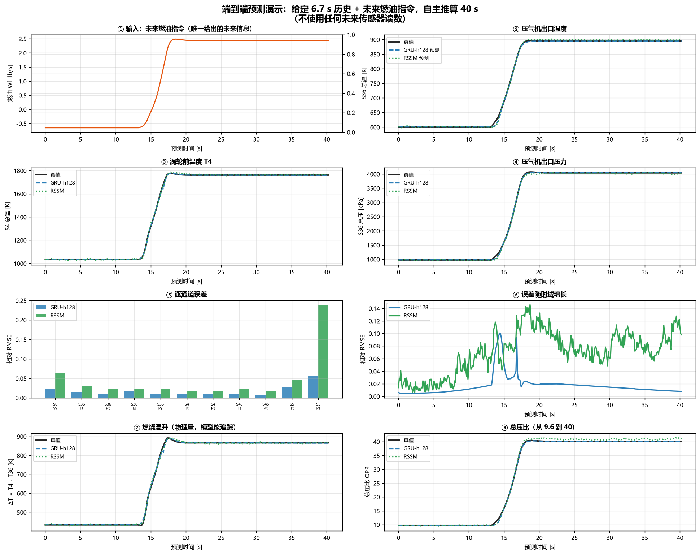

# 端到端预测演示

> 验证模型「能不能用」的最直接方式：给定历史观测 + 未来燃油指令，自主推算 40 秒。

---

## 运行

```bash
set PYTHONPATH=%CD%\src
python scripts/demo_predict.py      # 预测 + 打印数值
python scripts/plot_demo.py         # 出图
```

**依赖**：`checkpoints/capacity/h128_s0.pt`（GRU）、`checkpoints/v2_rssm.pt`（RSSM）

---

## 设置

| 项 | 值 |
|---|---|
| 历史窗口 | 64 步 = **6.7 s** |
| 预测长度 | 12 段 × 32 步 = **40.3 s** |
| 输入 | 历史观测（16 通道）+ **未来燃油指令** |
| **不提供** | **任何未来传感器读数** |
| 递推方式 | 每 32 步用自身预测替代历史，动作窗口同步右移 |

**动作时序**：`a[t-1] → o[t]`（因果，与训练一致）

---

## 结果（3 条 test 轨迹）

| 轨迹 | 激励 | Alt | MN | GRU-h128 | RSSM |
|---|---|---|---|---|---|
| `d01_step80_a00000_m00_g010` | step80 | 0 | 0.0 | **0.0168** | 0.0476 |
| `d02_step80_a00000_m06_g010` | step80 | 0 | 0.6 | **0.0167** | 0.0419 |
| `d07_step55_a00000_m00_g010` | step55 | 0 | 0.0 | **0.0281** | 0.0461 |

（相对 RMSE，归一化空间，11 个有效通道平均）

---

## 关键物理量对照（`d01`）

| 量 | 真值 | GRU 预测 |
|---|---|---|
| 压气机出口温度 S36_Tt | 1079.8 → 1609.8 °R | 1081.0 → 1610.3 °R |
| 涡轮前温度 S4_Tt | 1858.9 → 3169.1 °R | 1864.6 → 3166.6 °R |
| 压气机出口压力 S36_Pt | 141.3 → 586.2 psia | 141.9 → 587.4 psia |

**物理量换算**：°R × 5/9 = K；psia × 6.89476 = kPa

- 涡轮前温度：1033 K → 1761 K
- 压气机出口压力：974 kPa → 4042 kPa
- 总压比 OPR：9.6 → 40

**燃烧温升 ΔT = T4 − T36**：330 K → 890 K，预测准确追踪。

---

## 图说明



| 子图 | 内容 | 观察 |
|---|---|---|
| ① | 输入燃油指令 | 13–18 s 阶跃，之后恒定 |
| ② | 压气机出口温度 | 预测与真值几乎重合 |
| ③ | 涡轮前温度 T4 | 同上 |
| ④ | 压气机出口压力 | 同上 |
| ⑤ | 逐通道误差 | **RSSM 在 `S5_Pt` 通道误差达 0.24**，GRU 仅 0.05 |
| ⑥ | 误差随时域增长 | GRU 在 14 s 阶跃处跳变后回落至 0.01；RSSM 在 13 s 后升至 0.12 持续震荡 |
| ⑦ | 燃烧温升 ΔT | 330→890 K，预测准确 |
| ⑧ | 总压比 OPR | 9.6→40，预测准确 |

---

## 结论

**✅ 能预测**：给定 6.7 s 历史 + 未来燃油指令，模型可自主推算 40 s，相对误差 1.7–2.8%（GRU）。

**⚠ 三个限制**：

1. **仅限见过的工况族**
   演示轨迹是 `step80 @ Alt=0, MN=0`。train 中同工况仅 1 条，属于半外推。

2. **RSSM 明显更差**
   相对误差 0.042–0.048，比 GRU 差 2.5 倍。`S5_Pt` 通道误差 0.24。

3. **瞬态处误差放大**
   GRU 在阶跃时刻（t≈13 s）误差从 0.01 跳到 0.02；RSSM 跳到 0.12。

**❌ 不能做**：
- 传感器缺失场景（无 Mask 机制）
- 发动机退化场景（无隐藏参数数据）

---

## 数据文件

`results/prediction_demo.npz`（48 KB）：

```python
import numpy as np
d = np.load("results/prediction_demo.npz", allow_pickle=True)
# target     (384, 38)  真值（物理单位）
# pred_gru   (384, 38)  GRU 预测
# pred_rssm  (384, 38)  RSSM 预测
# action     (384, 1)   燃油动作（归一化）
# obs_cols   (38,)      列名
# start      int        历史窗口起点索引
```

---

## 复现这条轨迹的完整流程

```python
import json, numpy as np, torch
from pathlib import Path
import sys
sys.path.insert(0, "src")
from aero_world_model.models.baselines import BaselineGRU

# 1. 数据
d = np.load("data/data.npz", allow_pickle=True)
splits = json.load(open("data/splits.json"))
rid = splits["test"][0]          # d01_step80_a00000_m00_g010

STEP = 7
obs = d[f"{rid}_obs"][::STEP].astype(np.float32)   # (1143, 16)
act = d[f"{rid}_act"][::STEP].astype(np.float32)

# 2. 归一化（train 集拟合）
tr = np.concatenate([d[f"{r}_obs"][::STEP] for r in splits["train"]], 0)
o_mu, o_sd = tr.mean(0), tr.std(0) + 1e-8
tr_a = np.concatenate([d[f"{r}_act"][::STEP] for r in splits["train"]], 0)
a_mu, a_sd = tr_a.mean(0), tr_a.std(0) + 1e-8

# 3. 加载模型
model = BaselineGRU(16, 1, hidden=128, horizon=32,
                    mlp_units=512, mlp_layers=2)
model.load_state_dict(torch.load("checkpoints/capacity/h128_s0.pt"))
model.eval()

# 4. 递推（详见 scripts/demo_predict.py）
```

完整实现见 [`scripts/demo_predict.py`](../scripts/demo_predict.py)。
